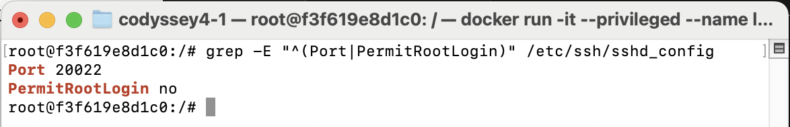
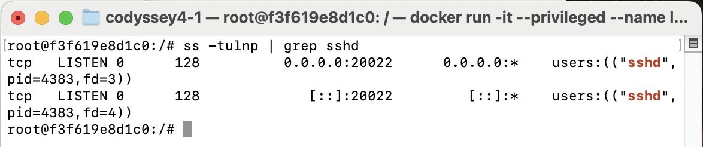
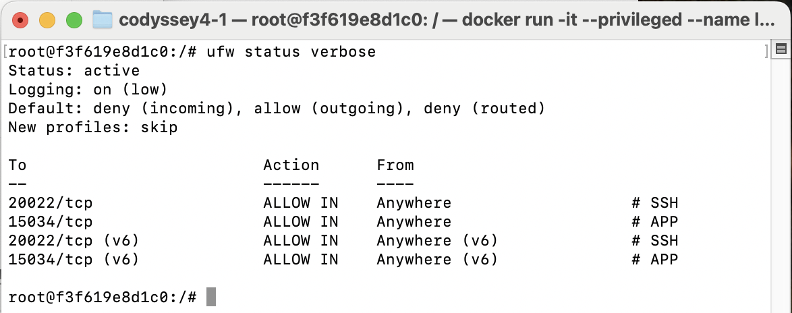
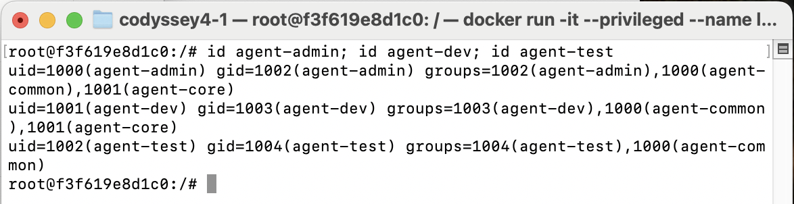
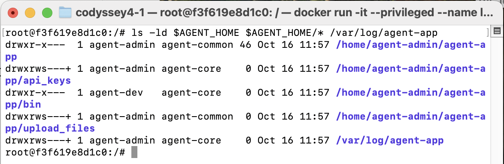
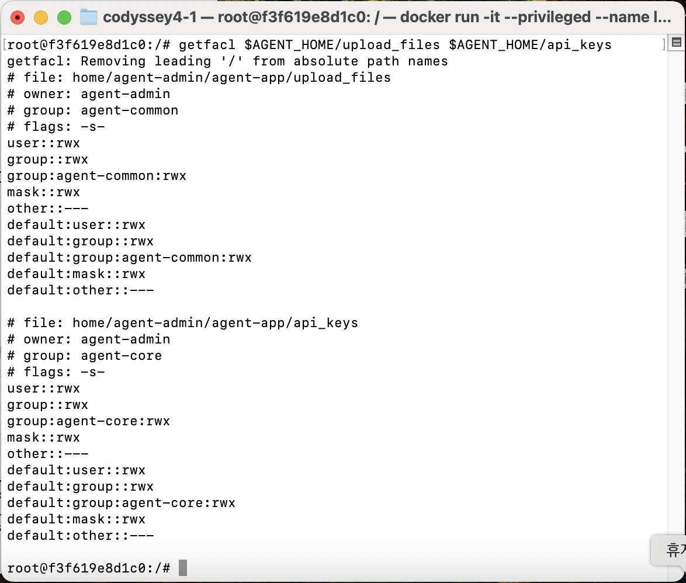
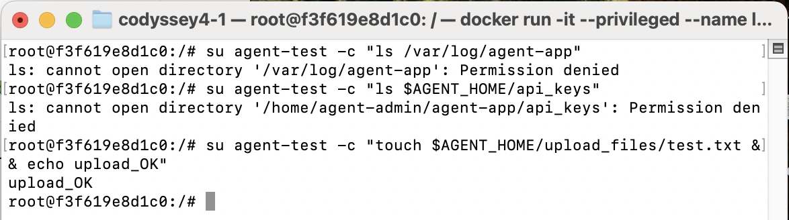

# Linux 서버 운영 미션 수행 내역서 (codyssey4-1)

> 작성 중인 임시 버전입니다. `(TODO)` 표시는 수행 후 채워 넣습니다.
> 증거 스크린샷은 `evidence/` 폴더에 저장하고 아래 링크로 연결합니다.

## 0. 환경

| 항목 | 내용 |
|---|---|
| 호스트 | macOS (Apple Silicon / Intel 중 택1: TODO) |
| 실행 환경 | Docker Desktop, `ubuntu:22.04` 컨테이너 (`--privileged`) |
| 컨테이너 이름 | `linux-mission` |
| 방화벽 | UFW |
| 제공 앱 | `agent-app-linux-arm64` `Intel Mac (x86_64)` |

```bash
docker run -it --privileged --name linux-mission -p 20022:20022 -p 15034:15034 ubuntu:22.04 /bin/bash
```

필수 패키지 설치

```bash
apt-get update && apt-get install -y \
  sudo openssh-server ufw iptables procps net-tools iproute2 vim acl cron git
```

> 컨테이너에는 systemd가 없어 `systemctl` 대신 `service ssh start`, `service cron start`를 사용한다.

---

## 1. SSH 설정 (포트 20022, Root 원격 접속 차단)

### 명령어

```bash
sed -i -E 's/^#?Port .*/Port 20022/' /etc/ssh/sshd_config
sed -i -E 's/^#?PermitRootLogin .*/PermitRootLogin no/' /etc/ssh/sshd_config
grep -E "^(Port|PermitRootLogin)" /etc/ssh/sshd_config

mkdir -p /run/sshd
sshd -t
service ssh start
ss -tulnp | grep sshd
```

### 확인 결과

```
Port 20022
PermitRootLogin no
tcp   LISTEN 0      128          0.0.0.0:20022      0.0.0.0:*    users:(("sshd",pid=4383,fd=3))
tcp   LISTEN 0      128             [::]:20022         [::]:*    users:(("sshd",pid=4383,fd=4))
```




---

## 2. 방화벽 (UFW)

### 명령어

```bash
ufw default deny incoming
ufw default allow outgoing
ufw allow 20022/tcp comment 'SSH'
ufw allow 15034/tcp comment 'APP'
ufw --force enable
ufw status verbose
```

### 확인 결과

```
Status: active
Logging: on (low)
Default: deny (incoming), allow (outgoing), deny (routed)
New profiles: skip

To                         Action      From
--                         ------      ----
20022/tcp                  ALLOW IN    Anywhere                   # SSH
15034/tcp                  ALLOW IN    Anywhere                   # APP
20022/tcp (v6)             ALLOW IN    Anywhere (v6)              # SSH
15034/tcp (v6)             ALLOW IN    Anywhere (v6)              # APP
```



---

## 3. 계정/그룹 생성

### 명령어

```bash
groupadd agent-common
groupadd agent-core

useradd -m -s /bin/bash agent-admin
useradd -m -s /bin/bash agent-dev
useradd -m -s /bin/bash agent-test

usermod -aG agent-common,agent-core agent-admin
usermod -aG agent-common,agent-core agent-dev
usermod -aG agent-common agent-test

id agent-admin
id agent-dev
id agent-test
```

### 확인 결과

```
uid=1000(agent-admin) gid=1002(agent-admin) groups=1002(agent-admin),1000(agent-common),1001(agent-core)
uid=1001(agent-dev) gid=1003(agent-dev) groups=1003(agent-dev),1000(agent-common),1001(agent-core)
uid=1002(agent-test) gid=1004(agent-test) groups=1004(agent-test),1000(agent-common)
```



---

## 4. 디렉토리 구조 및 권한 (ACL)

### 명령어

```bash
export AGENT_HOME=/home/agent-admin/agent-app
mkdir -p $AGENT_HOME/{upload_files,api_keys,bin} /var/log/agent-app

# 상위 디렉토리 통과 권한
chown agent-admin:agent-common $AGENT_HOME
chmod 750 $AGENT_HOME
setfacl -m g:agent-common:x /home/agent-admin

# 공유 디렉토리: agent-common
chown agent-admin:agent-common $AGENT_HOME/upload_files
chmod 2770 $AGENT_HOME/upload_files
setfacl -m g:agent-common:rwx $AGENT_HOME/upload_files
setfacl -d -m g:agent-common:rwx $AGENT_HOME/upload_files

# 보안 디렉토리: agent-core ONLY
chown agent-admin:agent-core $AGENT_HOME/api_keys /var/log/agent-app
chmod 2770 $AGENT_HOME/api_keys /var/log/agent-app
setfacl -m g:agent-core:rwx $AGENT_HOME/api_keys /var/log/agent-app
setfacl -d -m g:agent-core:rwx $AGENT_HOME/api_keys /var/log/agent-app

# bin
chown agent-dev:agent-core $AGENT_HOME/bin
chmod 750 $AGENT_HOME/bin
```

### 확인 결과

`ls -ld $AGENT_HOME $AGENT_HOME/* /var/log/agent-app`

```
drwxr-x---  1 agent-admin agent-common 46 Oct 16 11:57 /home/agent-admin/agent-app
drwxrwx---+ 1 agent-admin agent-core    0 Oct 16 11:57 /home/agent-admin/agent-app/api_keys
drwxr-x---  1 agent-dev   agent-core    0 Oct 16 11:57 /home/agent-admin/agent-app/bin
drwxrwx---+ 1 agent-admin agent-common  0 Oct 16 11:57 /home/agent-admin/agent-app/upload_files
drwxrwx---+ 1 agent-admin agent-core    0 Oct 16 11:57 /var/log/agent-app
```

`su agent-test`로 접근 테스트

```
$ ls /var/log/agent-app
ls: cannot open directory '/var/log/agent-app': Permission denied
$ ls $AGENT_HOME/api_keys
ls: cannot open directory '/home/agent-admin/agent-app/api_keys': Permission denied
$ touch $AGENT_HOME/upload_files/test.txt && echo upload_OK
upload_OK
```

- `upload_files`: agent-common만 읽기/쓰기 가능 (agent-test 쓰기 성공)
- `api_keys`, `/var/log/agent-app`: agent-core만 가능 (agent-test는 거부)





---

## 5. 환경 변수 / 키 파일

### 명령어

```
(TODO)
```

### 확인 결과

```
(TODO: env | grep AGENT, ls -l api_keys/)
```


---

## 6. 애플리케이션 실행

### 명령어

```
(TODO)
```

### 확인 결과

```
(TODO: Boot Sequence 5단계 [OK] 및 Agent READY)
(TODO: ss -tulnp | grep 15034)
```


---

## 7. monitor.sh

- 경로: `$AGENT_HOME/bin/monitor.sh`
- 소유자/그룹/권한: `agent-dev:agent-core`, `750`

```
(TODO: ls -l 결과)
(TODO: 수동 실행 결과, 경고 출력 포함)
```


소스코드는 [monitor.sh](monitor.sh) 참고.

---

## 8. 로그 기록 및 용량 관리

```
(TODO: tail -n 10 /var/log/agent-app/monitor.log)
```


- 로그 용량 관리 방식: (TODO: 스크립트 로직 10MB / 10개 파일 유지)

---

## 9. crontab 자동 실행

```
(TODO: crontab -l 결과)
(TODO: 1분 후 로그 라인 증가 전/후 비교)
```


---

## 10. 개념 설명

### SSH 포트 변경과 Root 원격 접속 차단이 기본 보안인 이유
(TODO)

### 공유 디렉토리와 보안 디렉토리를 분리하는 이유
(TODO)

### 환경 변수로 실행 환경을 고정하는 이유
(TODO)

### 로그 보존 정책(로테이션)이 필요한 이유
(TODO)

---

## 11. 트러블슈팅

| 문제 | 원인 | 해결 |
|---|---|---|
| (TODO) | | |
